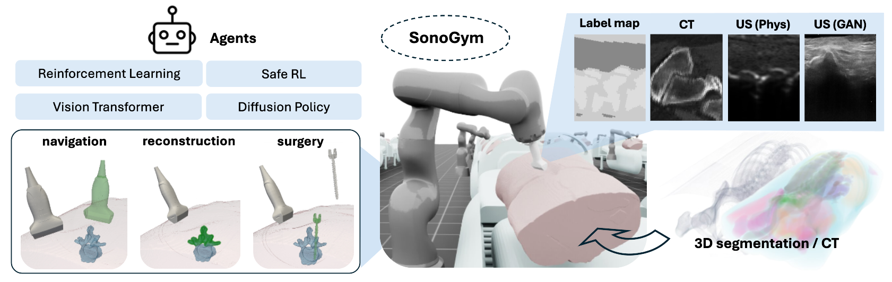

# SonoGym: High Performance Simulation for Challenging Surgical Tasks with Robotic Ultrasound

[](https://isaac-sim.github.io/IsaacLab/main/source/setup/installation/pip_installation.html)
[](https://isaac-sim.github.io/IsaacLab)
[](https://docs.python.org/3/whatsnew/3.11.html)


## Overview



SonoGym is a scalable training platform for challenging (orthopedic) surgical tasks with robotic ultrasound, built on NVIDIA IsaacLab (https://github.com/isaac-sim/IsaacLab). We provide model-based and learning-based ultrasound (US) simulation based on 3D label map and CT scans from real patient datasets.
Our tasks include path planning for US navigation, bone surface reconstruction, and US-guided robotic surgery. 
Our platform enables benchmarking of various algorithms, including reinforcement learning (RL), safe RL, and imitation learning.


## Installation
### Install codes
- Install Isaac Lab by following the [installation guide](https://isaac-sim.github.io/IsaacLab/v2.1.0/source/setup/installation/pip_installation.html) (IsaacLab V2.1.0). We recommend using the conda installation as it simplifies calling Python scripts from the terminal.

- Clone this repository separately from the Isaac Lab installation (i.e. outside the `IsaacLab` directory):

```bash
# Option 1: HTTPS
git clone https://github.com/SonoGym/SonoGym.git

# Option 2: SSH
git clone git@github.com:SonoGym/SonoGym.git
```


- Using a python interpreter that has Isaac Lab installed, install the library

```bash
python -m pip install -e source/spinal_surgery --no-dependencies
```
### Download simulation assets and ultrasound simulation models
Download the simulation assets and ultrasound simulation models from https://huggingface.co/datasets/yunkao/SonoGym_assets_models

The folder contains 2 archived folders:
- assets: simulation assets including medical imaging, human models, robots and end-effectors.
- models: pix2pix models for learning-based ultrasound simulation.


Unzip and put the downloaded directories in the following path respectively:
```
assets -> SonoGym/source/spinal_surgery/spinal_surgery/assets
models -> SonoGym/models
```

### Download expert dataset (optional)

Download the dataset from https://huggingface.co/datasets/yunkao/SonoGym_lerobot_dataset following the instruction in https://huggingface.co/docs/hub/en/datasets-downloading or https://huggingface.co/docs/huggingface_hub/main/en/guides/download.

This dataset allow training imitation learning policies with lerobot repo (https://github.com/huggingface/lerobot) for surgery and navigation, not necessary for training RL agents.

Specifically, they are collected with the following settings:
- ```Isaac-robot-US-guidance-v0-single```: ultrasound guidance, single patient, model-based US simulation
- ```Isaac-robot-US-guidance-v0-single-net```: ultrasound guidance,single patient, learning-based US simulation
- ```Isaac-robot-US-guidance-5-models-v0```: ultrasound guidance,single patient, 4 learning-based US simulation networks
- ```Isaac-robot-US-guided-surgery-v0-single-new```: ultrasound-guided surgery, single patient, model-based US simulation
- ```Isaac-robot-US-guided-surgery-v0-single-net-new```: ultrasound-guided surgery, single patient, learning-based US simulation
- ```Isaac-robot-US-guided-surgery-v0-5-net```: ultrasound-guided surgery,single patient, 4 learning-based US simulation networks
- ```Isaac-robot-US-guided-surgery-v0-5```: ultrasound-guided surgery,5 patient, model-based US simulation


It is recommended to put the downloaded dataset in the following path:
```
SonoGym/lerobot-dataset
```

## Play with teleoperation
Yon can play the robot with keyboard in a task environment with the following command:

(**Note: When you run it the first time, IsaacSim might take long to load**)

```bash
python workflows/teleoperation/teleop_se3_agent.py --task=Isaac-robot-US-guidance-v0
```

```--task``` argument can be chosen from
- Isaac-robot-US-guidance-v0
- Isaac-robot-US-guided-surgery-v0
- Isaac-robot-US-reconstruction-v0

## Training and testing

### Training with default settings

Before running the following training scripts, set all environment visualization to ```false``` following the **Change environment settings** section.

#### Reinforcement learning agents
You can train PPO agent with skrl with the following command:

```bash
python workflows/skrl/train.py --task=Isaac-robot-US-guidance-v0
```

You can also train PPO with a cost predictor only for ```Isaac-robot-US-guided-surgery-v0``` with the following command:
```bash
python workflows/skrl/train_sppo.py
```

The reinforcement learning agent dafault configs can reproduce our results in the paper. You can modify the configs at 
```
source/spinal_surgery/spinal_surgery/tasks/{tasks_name}/agents/skrl_{algorithm}_cfg.yaml
```

#### Imitation learning agents

To train imitation learning agents, first install ```lerobot``` from https://github.com/huggingface/lerobot/tree/a445d9c9da6bea99a8972daa4fe1fdd053d711d2 

After downloading the expert dataset, you can also train ACT or diffusion policy with:

```bash
python /path-to-lerobot/lerobot/scripts/train.py --config_path=workflows/lerobot/train_surgery_{method}_cfg.json
```
where ```method``` can be either 'diffusion' or 'act'. Remmember to change ```"dataset": "root"``` to the path of your local dataset like ```path-to-repo/SonoGym/lerobot-dataset/Isaac-robot-US-guidance-v0-single-net```.


### Change environment settings
Environment configurations are located under

```bash
source/spinal_surgery/spinal_surgery/tasks/{task_name}/cfgs/{task_name}.yaml
```
For example, you choose model-based or learning-based ultrasound simulation for the ```robot_US_guidance``` task by setting
```
sim:
    us: 'net'  # for learning-based, or 'conv' for model-based 
```
in ```source/spinal_surgery/spinal_surgery/tasks/robot_US_guidance/cfgs/robot_US_guidance.yaml```.

To turn on or turn off the visualization, you can also set

```
sim:
    vis_us: true  # or false
```

If the program died only with ```vis_us``` on, try uninstall ```PyQt5``` and reinstall ```opencv-python```. 

### Play a checkpoint
PPO checkpoint can be played via:
```bash
python workflows/skrl/play.py --task {task_id} --checkpoint /path-to-checkpoint --num_envs 100
```
PPO + safety filter checkpoint for the ultrasound-guided-surgery environment can be played via:
```bash
python workflows/skrl/play_sppo.py --checkpoint /path-to-checkpoint --num_envs 100
```
lerobot checkpoints (for example, ACT for ```ultrasound guidance```) can be played by:
```
python workflows/lerobot/play_lerobot_guidance.py --policy.config=workflows/lerobot/play_guidance_act_cfg.json --policy.path=/path-to-checkpoint/pretrained_model
```

